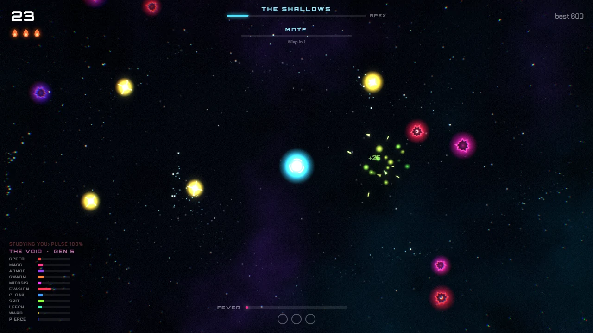
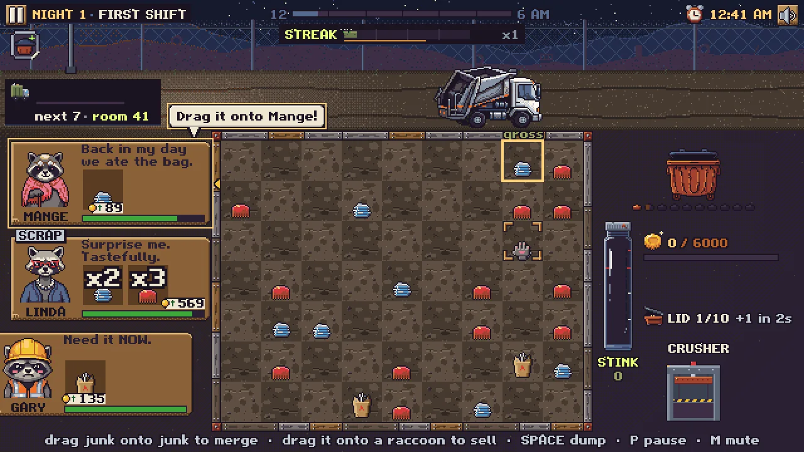

A big week. Four games got major updates and two new ones are up.

## Verdant Relay: the signal update

[Verdant Relay](/games/verdant-relay/) has an ending now. Kill the five area bosses across your runs, build the Uplink for 800 Research, then hold its signal through the Canopy Colossus.

- **Shorter runs:** 4 nights, about 35 minutes. It used to be 6 nights.
- **You fight at night:** your scavenger is on the board beside the towers. Hold E at a tower to overcharge it.
- **What you find builds the run:** a run starts with three towers, and the Thorn Nest, Mortar Pod and Pulse Totem are blueprints you find in the jungle, and tower mods and machete upgrades are found, not crafted.
- **More to chase:** four scavengers and eight legendary relics, each opened by a feat.
- **Less to read:** a fresh first run shows about 17% fewer words, and the extra systems wait for run 2.

Your Research and unlocks carry over, but a run saved before the update can't continue.

## Ember 1.0: The Void's Turn

[Ember](/games/ember/) hit 1.0. The void now answers how you kill it: pulse kills grow shells, loop kills grow wards, and each answer names its counter. Split your kills so no weapon makes 60% of them and the void can't read you. Forms are earned, every apex you slay evolves you, and the void remembers you between runs. A bot's typical run went from 174 seconds to 300.

## Foldworks: the Playability Update

[Foldworks](/games/foldworks/) had a full playability review and then a lot of changes. Folding is now the second research, so a bot's first fold went from 24 minutes to about 5. Finishing the Floating City is the ending, with credits. Machine Kits, machine modes, Inspiration and the Lucky Vein are cut, and the District routes itself. Old saves are converted.

## Goblin Pension Plan: Chapter Two

[Goblin Pension Plan](/games/goblin-pension-plan/) got a playability pass and a second chapter. The first trip has a fight of your own now, a guide line names your next step, and Chapter Two is the actual pension plan: six rungs of permits from the Goblin Door to the Four-Poster, each one changing the Burrow, up to Retirement Day.

## New: Dumpster Alchemy

[Dumpster Alchemy](/games/dumpster-alchemy/) is a gross, loud merge game. You run the night shift at a raccoon-run landfill: merge junk into better junk, brew 20 recipes, feed the raccoons and keep the stink down. Version 2.0 makes a run 10 nights across the County Dump with three boss nights.

## New: Nobody Mention the Moon

[Nobody Mention the Moon](/games/nobody-mention-the-moon/) is a co-op dinner party for up to 6. Every guest is a monster pretending to be human, and they all think you're one too. Your voice counts: say "moon" near the werewolf and you'll find out why it's the title. The web version is solo only for now, because online dinners need a game server that isn't hosted yet.

Both new games are on the Prototypes shelf.
