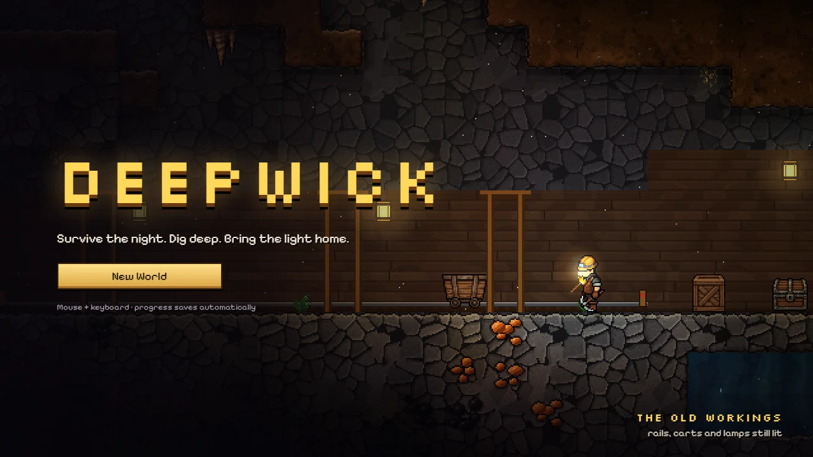
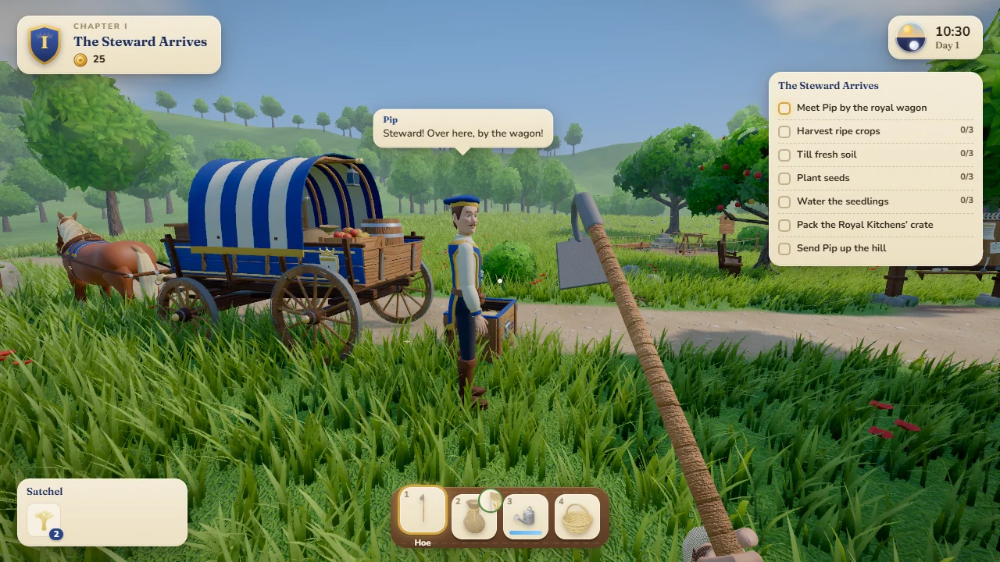
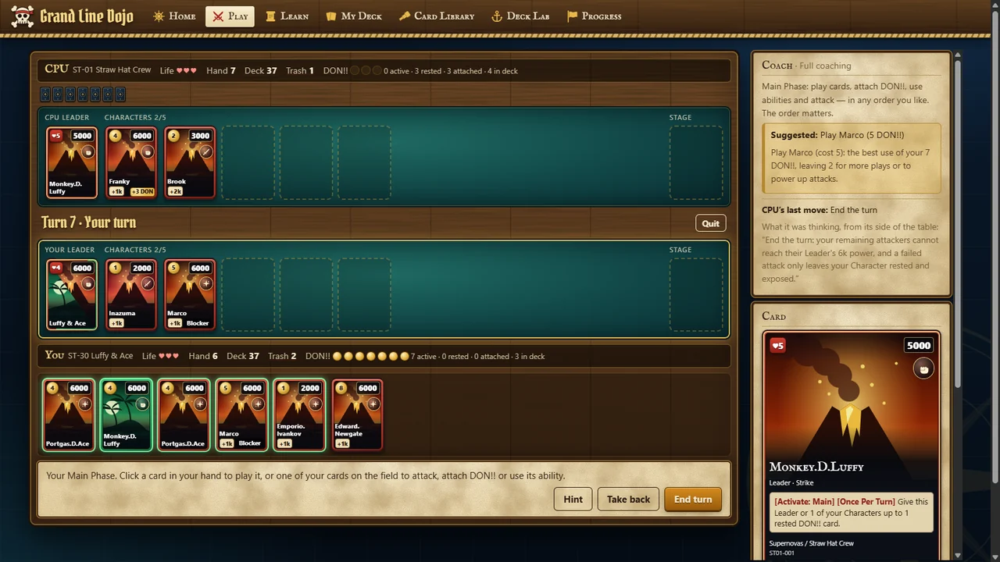

Deepwick and Aldervale went up as prototypes earlier today, and both have already had a big update. There's a third new game too.

## Deepwick: the old mines

[Deepwick](/games/deepwick/) had two updates. The first rebuilt the underground.

- **The old Deepwick mines:** timbered shafts, ladders, rails and hanging lamps, left from when the town was working.
- **Minecarts:** press E to climb in, A and D to roll, Space to jump out. Rails, minecarts and mine lamps can be crafted at the anvil.
- **A grappling hook:** forged at the anvil. G or a click throws it, W and S climb the rope, Space jumps off.
- **Each layer looks different:** seamless rock, a cave backdrop for every biome, and rock formations.

The second added water.

- **Ponds and cave pools:** swim with Space. Water runs into the holes you dig, and turns lava to obsidian.
- **Fishing:** a Fishing Rod from the workbench or from Pell, and a Brass Rod from the anvil. Cast, hook, then reel on the timing. There are seven fish depending on where you cast, plus junk and sunken purses, Grilled Fish to cook, and a Fishing skill.
- **The title screen is the game:** it tours the mine head at dusk, a meadow pond, a lamplit drift and a cavern from each deep layer.

The mines update uses a new save, so a world from before it won't carry over. A save made after it keeps working and gets the cave pools.

## Aldervale: the steward's year

[Aldervale](/games/aldervale/) was built around an order board. Now it's a story in five chapters, from The Steward Arrives to The Harvest Feast. The order board, XP levels and production queues are gone.

- **Letters and objectives:** each chapter opens with a letter and lists what to do, with markers in the world.
- **Pip's wagon:** commissions are packed into a crate, and Pip drives them up to the castle with a pony and wagon.
- **Land cleared by hand:** with a new axe and pick.
- **Buildings you work in the world:** the windmill's hopper, the hen run and the bakehouse oven.
- **More farm:** Wren's stall for seeds, upgrades and selling, carrots and cabbages, apple trees, compost, sleep and rain.
- **Also new:** sound, settings, a journal and new models.

## New: Grand Line Dojo

[Grand Line Dojo](/games/grand-line-dojo/) is an unofficial, fan-made trainer for the One Piece Card Game. It's single player: you play the ST-30 "Luffy & Ace" starter deck against six CPU starter decks, and a coach explains every decision.

- **24 lessons** with quizzes, plus counter-maths and lethal drills.
- **A Card Library** of all 2,980 cards as text.
- **Deck Lab** to build a list, check it and test it against the CPU.

Its limits: 1,232 of those cards (41%) can be played in matches, and the CPU is rule-based, so it's a sparring partner for fundamentals. Every picture is an original drawing. No official card artwork is used, and the project isn't affiliated with or endorsed by the card game's owners.

It's on the Prototypes shelf.
