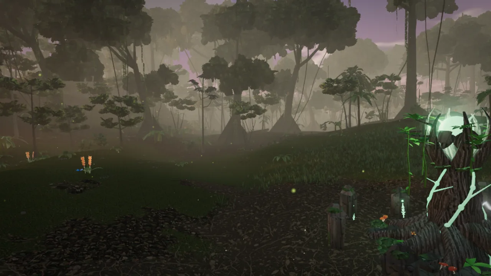
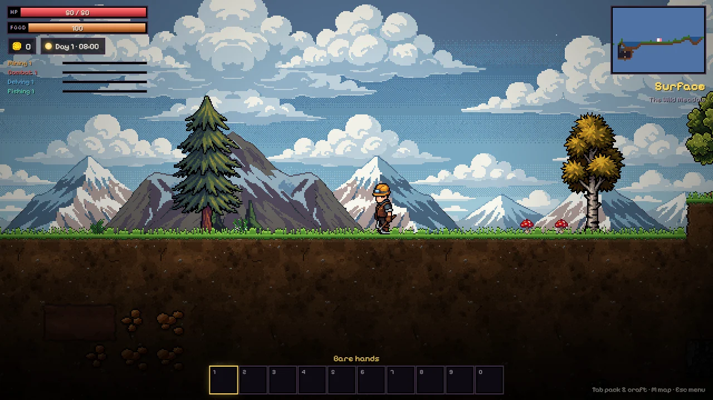
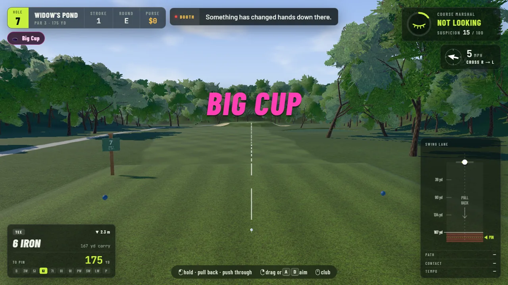

Two games got big updates and three new prototypes are up.

## Overgrowth 1.1, 1.2 and 1.2.1

[Overgrowth](/games/overgrowth/) had three releases since the last post.

- **1.1, "New Growth":** rebuilt trees, remodelled Wisp, Husk and Rot Mother, and about a third of the triangles drawn.
- **1.2, "Hold Fast":** a full playthrough review of 1.1 found a list of problems, and this fixes them.
  - The machete answers every click. A click during a swing is kept for 0.4 s, where 1.1 dropped it.
  - Continue picks up at the hour you left. It used to rewind to dawn.
  - Six top-tier bow towers could hold night 10 alone. Now arrows glance off Rotboars and bosses, so a mixed defence holds where one kind falls.
  - The Blood Moon never counted for the golden idol, so the true ending couldn't be reached. It counts now.
- **1.2.1, "Quiet Hours":** 1.2's night music was a drone under two drum notes on a loop. Now nothing loops: a chord swells every half-minute to a minute, with the forest in between.

## Fins & Fronds 0.3

[Fins & Fronds](/games/fins-and-fronds/) had a full critique: 188 findings, fixed in six batches.

- **An ending:** when the Grand Oceanarium opens, a short finale plays. The shop carries on afterwards.
- **Letters write back:** every correspondent has a little story now, and each finished one leaves a keepsake.
- **A week:** Friday is a school trip, Saturday is market day and Sunday is the Driftwood Club's judging.
- **Rays** and a Ray Lagoon to keep them in, plus conservation projects to spend spare coins on.
- **Fishkeeping fixes:** reef tanks settle at a reef pH, so saltwater animals are no longer "too alkaline".

## New: Deepwick

[Deepwick](/games/deepwick/) is a 2D survival and mining game. You wake in a meadow with nothing, build a shelter before the first night, then dig down through five layers of caves.

## New: Bullshit Golf

[Bullshit Golf](/games/bullshit-golf/) plays the golf straight, with real ball flight and a mouse swing, then lets you cheat. Bend the ball in mid-air, take a cheat card from your caddie, and keep an eye on the course marshal. At 100 suspicion you're disqualified. Two holes so far.

## New: Aldervale

[Aldervale](/games/aldervale/) is a first-person farm below a castle. Grow wheat, tomatoes and pumpkins, fill the royal requisitions pinned to the board, and earn coin and Royal Favour. It's an early build.

All three new games are on the Prototypes shelf.
